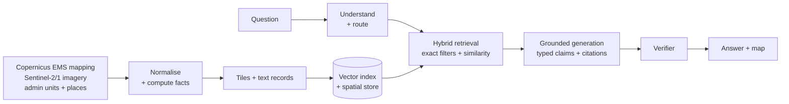

# TileTrace

**Grounded question-answering over South Asian disaster imagery.**

Ask *"How many buildings were destroyed in Puri during Cyclone Fani?"* or *"Find areas that looked like this after the 2025 Pakistan floods"* and get an answer grounded in satellite imagery and official damage mapping. Every claim cites its source record or image tile, and when the evidence isn't there, the system says so.

TileTrace is a retrieval-augmented generation (RAG) system built as a learning project. Each stage is developed step by step in Jupyter notebooks but designed like a real system, with typed data contracts, evaluation against ground truth, and tracing.

> **Status:** Phase 0 (architecture & system design) complete. Phase 1 (data foundations, in notebooks) is next.
> Full design: [docs/superpowers/specs/2026-10-19-tiletrace-design.md](docs/superpowers/specs/2026-10-19-tiletrace-design.md)

## Who it's for

District disaster-management officers and NGO planners in South Asia who are preparing for the next monsoon or cyclone season. They know their region but don't write GIS code. TileTrace is for **preparedness and post-event review**, not live response.

## How it works



- **Ground truth is data, not model output.** Counts and areas are computed in the pipeline; the model only selects and phrases them.
- **Hybrid retrieval.** Exact filters (place, event, date, hazard) handle what's known exactly; vector similarity handles what's fuzzy, including visual "looks like this" search over image tiles.
- **Verified answers.** The generator returns typed claims (`fact` / `visual`) with citations. Code checks that every citation was actually retrieved and every number appears in a cited record.
- **Evals first.** A gold question set generated from official ground truth measures retrieval, answer accuracy, citation validity, groundedness and refusals.

## Data

| Source | What | Licence |
|---|---|---|
| [Copernicus EMS Rapid Mapping](https://mapping.emergency.copernicus.eu/) | 26 South Asia activations (2013–2026): flood extents, graded building damage, impact stats | Free with attribution, © European Union, Copernicus Emergency Management Service |
| [Microsoft Planetary Computer](https://planetarycomputer.microsoft.com/) | Sentinel-2 L2A and Sentinel-1 RTC imagery | Copernicus Sentinel data, open |
| [geoBoundaries](https://www.geoboundaries.org/) | Administrative boundaries | ODbL 1.0 |
| [OpenStreetMap](https://www.openstreetmap.org/) | Named places | ODbL 1.0, © OpenStreetMap contributors |

Raw data is not committed. Rebuild it with:

```bash
uv run scripts/harvest_ems.py              # Copernicus EMS products, South Asia (~7 GB)
uv run scripts/download_sentinel2.py       # Sentinel-2 prototype scenes (Fani / Puri)
uv run scripts/download_boundaries.py      # geoBoundaries admin units
uv run scripts/download_osm_places.py      # OSM settlements
```

## Roadmap

| Phase | Theme | Status |
|---|---|---|
| 0 | Architecture & system design | ✅ Done |
| 1 | Data foundations: explore, normalise, scene selection, tiles and facts | Next |
| 2 | Evals first: gold set, embeddings, baseline retrieval | |
| 3 | Better retrieval: query understanding, hybrid + rerank, visual search | |
| 4 | Grounded generation: structured answers, verifier, groundedness evals | |
| 5 | Scale to all 15 Sentinel-2-era events; optional API and map UI | |

## Repository layout

```
docs/        design documents
scripts/     reproducible data acquisition
notebooks/   step-by-step implementation (phase 1+)
src/         tiletrace package, promoted from notebooks (phase 1+)
data/        git-ignored
```

## License

MIT. See [LICENSE](LICENSE). Data sources keep their own licences (above).
