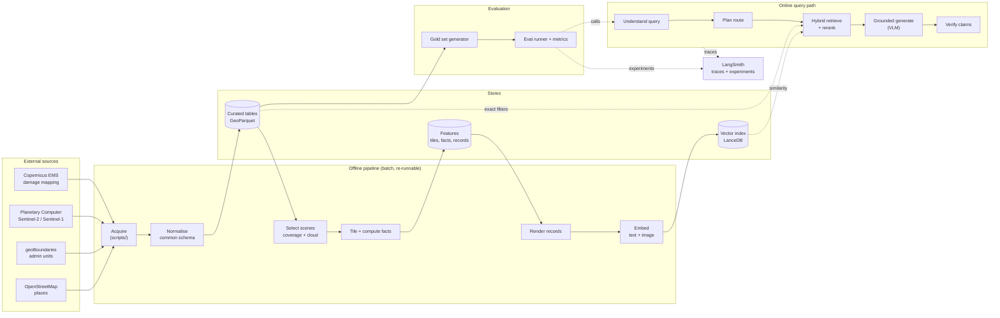
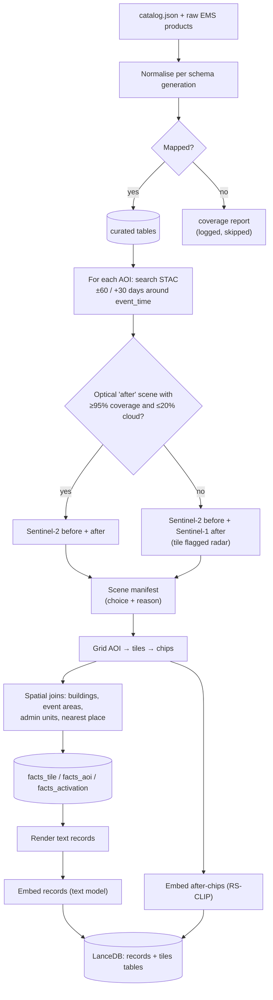
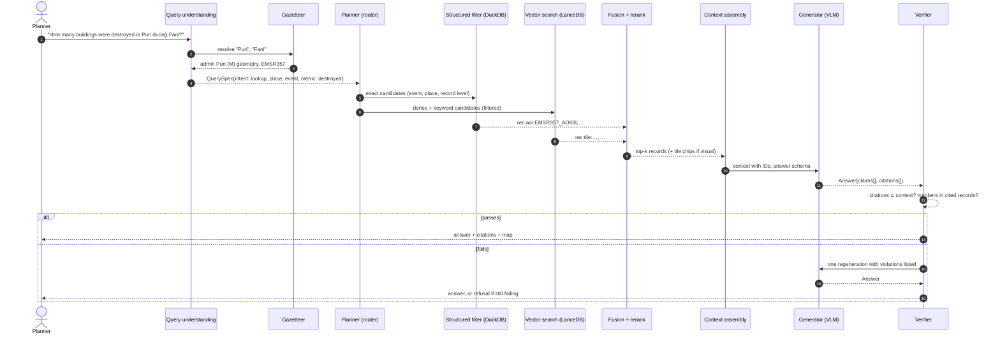
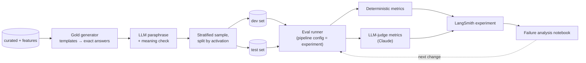

# TileTrace — System Design

**Grounded question-answering over South Asian disaster imagery**

| | |
|---|---|
| Status | Phase 0 (architecture & system design) — complete, pending review |
| Date | 2026-10-19 |
| Author | Anand Natarajan S (with Claude) |

Notation: **[decided]** = decided by the project owner. **[call]** = design recommendation, accepted by default and open to challenge. **[builder]** = deliberately left open until implementation.

---

## 1. Intent

Satellite archives can be filtered by place, date and cloud cover, but not by *content*. Nobody can ask "which areas of Puri were destroyed in Cyclone Fani?" or "show me areas that looked like this after the 2025 Pakistan floods". Answering those today takes someone fluent in QGIS or Earth Engine, and those people sit in a few central agencies. District-level questions wait in line, and comparing past events before the next season rarely happens at all.

TileTrace is a **retrieval-augmented generation (RAG) system**. A planner asks a plain-language question and gets an answer grounded in satellite imagery and official damage mapping. Every claim cites the record or image tile it came from, and when the evidence isn't there, the system says so.

- **Primary user [decided]:** a district disaster-management officer or NGO planner in South Asia, preparing for the next monsoon or cyclone season. They know their region but can't write GIS code.
- **Scope of use [decided]:** preparedness and post-event review, **not** live response.
- **Purpose [decided]:** a **learning project**. It's built step by step in Jupyter notebooks so every stage can be run, inspected and understood. It should still be designed like a real system (clear contracts, evaluation, observability), because learning that is the point.

## 2. Goals, non-goals, anti-goals

**Goals**
1. Answer natural-language questions about past South Asian disasters, grounded in Copernicus EMS damage mapping and Sentinel imagery.
2. Support three kinds of question: **fact lookup** ("how many buildings were destroyed in X?"), **comparison** ("which was worse, A or B?") and **visual similarity** ("find areas that look like this tile").
3. Make **evaluation and groundedness the centrepiece**, with metrics computed against official ground truth wherever possible.
4. Teach each RAG concept in its own notebook: data, chunking, embeddings, indexing, retrieval, reranking, generation, evaluation. Each notebook ends with an inspectable artefact.
5. Keep ingestion **repeatable and extensible**: adding a disaster means re-running the pipeline with its EMS activation code.

**Non-goals (for now)**
- Agents, tool use and autonomous workflows. This is a fixed RAG pipeline; agents come later [decided].
- Live response. A public, always-on deployment is optional [decided: learning purpose].
- Detecting floods or damage from raw imagery ourselves. EMS mapping is the ground truth.
- Fine-tuning models.
- Coverage outside South Asia (the pipeline allows it; scope doesn't).
- Situation reports and other text sources (later phase).
- Non-English queries [call]. Local place spellings are handled by fuzzy gazetteer matching.

**Anti-goals (failure even if it "works")**
- Any answer stating a number or place that the cited evidence doesn't contain.
- Citations pointing to records the model never saw.
- Evals that rely only on an LLM grading itself, or that one huge event dominates.
- Overclaiming live-response ability or village-level precision.
- Tuning on the test set; hard-coded demo answers.

## 3. Starting point (already built)

Data-acquisition scripts in `scripts/` are self-contained `uv run` scripts with inline dependencies. Raw data lives under `data/raw/`, which is git-ignored and reproducible.

| Script | Produces |
|---|---|
| `harvest_ems.py` | `data/raw/ems/<EMSR>/…` + `catalog.json`: 26 South Asia rapid-mapping activations (2013–2026), 362 products, ~7 GB. Dashboard API route (2025+, with `activation.json` impact stats and image dates) and legacy page route. |
| `download_sentinel2.py` | Fani/Puri prototype scenes (2019-04-28, 2019-05-18). To be generalised. |
| `download_boundaries.py` | geoBoundaries India ADM3, clipped to the Odisha coast. To be generalised. |
| `download_osm_places.py` | OSM settlements in the Puri bbox, with Overpass mirror fallback. To be generalised. |

**Facts about the data that drive the design**
- About 133k EMS event polygons and 271k building points; most buildings are graded *Destroyed / Damaged / Possibly damaged*.
- 15 activations (~89 AOIs) fall in the Sentinel-2 era (2017+): EMSR205, 272, 296, 318, 357, 439, 459, 505, 584, 629, 631, 838, 839, 851, 927.
- **EMS schemas differ across generations.** File names, layer names and fields changed over time, and some activations are reference or camp-monitoring maps with no damage layer.
- **Feature counts are heavily skewed**, e.g. 114k buildings for EMSR505 and 85k for EMSR839 against under 5k for many events.
- Open gazetteers (OSM, GeoNames) are sparse in rural South Asia, so answers can't promise village-level precision.
- Sentinel-2 swath edges can clip an AOI while reporting low cloud, so scene selection must check **coverage** as well as cloud.

## 4. Constraints

- **Compute:** CPU-only Windows laptop. Heavy inference goes to hosted APIs; batch embedding runs locally overnight if needed.
- **Budget [decided]:** Nebius Token Factory $25, LangSmith $100, Fireworks $15, Toloka $50, Replit $20, Tavily $25, LlamaIndex 50k credits, Pinecone free tier, Codex (1 month), personal Claude API $20/month, open-source Hugging Face models.
- **Licences:** Copernicus EMS (free use with attribution "© European Union, Copernicus Emergency Management Service"), Sentinel (open), geoBoundaries and OSM (ODbL). Every derived artefact keeps source attribution.
- **Tooling [call]:** Python 3.10+, `uv`, JupyterLab, and a `src/tiletrace` package that notebooks import.

---

## 5. Architecture

### 5.1 Design principles [call]

1. **Ground truth is data, not model output.** All counts, areas and aggregates are computed in the pipeline. The LLM only selects and phrases them.
2. **Every stage writes an inspectable artefact.** Data moves through explicit layers (raw → curated → features → index), each a file you can open in a notebook.
3. **Evals before optimisation.** The gold question set exists before any retrieval tuning, so every change is measured.
4. **Structured where possible, semantic where needed.** Use exact filters (place, date, event, hazard) for what is known exactly, and vector similarity for what is fuzzy.
5. **Answers are data too.** The generator returns typed claims with citations, and code verifies them before any prose is shown.
6. **Small swappable interfaces** for LLMs, embedders and vector stores, so models can be compared as experiments.
7. **Trace and cache everything.** Each request is traced end to end, and model calls are cached so iterating doesn't burn credits.
8. **Notebook explores, module keeps.** Code is written in a notebook first, then promoted into `src/tiletrace` once it's stable, and later notebooks import it.

### 5.2 System overview



### 5.3 Layers and responsibilities

| Layer | Responsibility | Main artefacts | Package module |
|---|---|---|---|
| Acquisition | Download raw sources reproducibly | `data/raw/**` | `scripts/` |
| Curation | Map every EMS generation onto one typed schema | `data/curated/*.parquet` | `tiletrace.ingest` |
| Features | Scenes, tiles, per-tile/AOI/activation facts, place labels | `data/features/**` | `tiletrace.features` |
| Records | Text records rendered from facts, ready to embed and cite | `data/features/records.parquet` | `tiletrace.records` |
| Index | Text and image embeddings in a vector store, plus a spatial store | `data/index/` | `tiletrace.index` |
| Retrieval | Query understanding, routing, hybrid search, rerank, context assembly | — | `tiletrace.retrieve` |
| Generation | Structured grounded answers and a deterministic verifier | — | `tiletrace.generate` |
| Evaluation | Gold set, runners, metrics, experiment logging | `data/eval/**` | `tiletrace.evaluate` |
| Providers | LLM, VLM, embedder, reranker and vector-store adapters, with caching | `.cache/` | `tiletrace.providers` |
| Interface | Notebooks now; API and map UI later | `notebooks/` | `tiletrace.app` (later) |

---

## 6. Data architecture

### 6.1 Storage layout [call]

```
data/
  raw/        as downloaded (bronze)        ems/, sentinel2/, geoboundaries/, osm/
  curated/    typed, normalised (silver)    activations, aois, products, event_areas, buildings, admin_units, places
  features/   derived (gold)                scenes/, tiles/ (PNG chips + COG refs), tiles.parquet, facts_*.parquet, records.parquet
  index/      vector store files            lancedb/
  eval/       gold sets and run outputs     gold_v1.parquet, runs/<run_id>/
```

Every derived file carries a `pipeline_version` and a `source_hash` (a hash of its inputs), so a notebook can tell when it's stale. Everything under `data/` is git-ignored. Code and configs are versioned; data is rebuilt.

### 6.2 Data contracts (curated layer)

| Table | Key | Main fields |
|---|---|---|
| `activations` | `activation_id` (EMSR357) | name, hazard, countries, event_time, activation_time, gdacs_id, impact_stats (JSON, when available), source_route |
| `aois` | `aoi_id` (EMSR357_AOI08) | activation_id, aoi_number, aoi_name, geometry |
| `products` | `product_id` (EMSR357_AOI08_GRA_v2) | aoi_id, type (FEP/DEL/GRA/REF/MONITnn), version, source_image_dates, sensors, is_latest |
| `event_areas` | `event_area_id` | product_id, event_type (flood, flood_trace, damage_zone, burnt_area…), observed_date, geometry |
| `buildings` | `building_id` | product_id, damage_grade ∈ {destroyed, damaged, possibly_damaged, no_visible_damage, not_analysed}, geometry |
| `admin_units` | `admin_id` | country, level, name, geometry |
| `places` | `place_id` | name, place_type, source (OSM), geometry |

**Normalisation rules [call]:**
- A per-generation mapping table maps legacy and current layer and field names onto these contracts. Unmappable layers are logged in a coverage report, never silently dropped.
- Only the latest version of each product is used (`is_latest`).
- **Building damage counts come only from GRA products.** Building layers in other products are context, not ground truth.
- **Event extents are kept per product date.** FEP, DEL and MONITnn products each produce dated rows; nothing is merged or overwritten.

### 6.3 Features layer

| Artefact | Key | Content |
|---|---|---|
| `scenes` | `scene_id` | aoi_id, role (before/after), sensor (S2/S1), datetime, cloud % and coverage % over the AOI, selection reason |
| `tiles` | `tile_id` (EMSR357_AOI08_r04_c07) | aoi_id, row, col, bbox, before/after scene_ids, chip paths, nodata/cloud fraction, admin_id, nearest place + distance + bearing |
| `facts_tile` | `tile_id` | building counts by grade, flooded ha and fraction per date, max flooded fraction, damage-zone fraction, burnt fraction |
| `facts_aoi` | `aoi_id` | the same aggregates, **max observed extent** (union of dated extents) plus per-date figures, and EMS impact stats |
| `facts_activation` | `activation_id` | event-level aggregates and impact stats |
| `records` | `record_id` | `rec:tile:…`, `rec:aoi:…`, `rec:act:…`, plus rendered text, filter metadata and source attribution |

**Tiling [call]:** 224 × 224 px at 10 m (2.24 km square) on a fixed grid per AOI, matching CLIP-family encoder input. Tiles over 50% no-data or cloud are dropped. Tiles with zero damage are **kept**, because they answer "was X affected?" with "no".

**Record example:**

> *Tile EMSR357_AOI08_r04_c07 — Cyclone Fani, Odisha, India (event 2019-05-03). Puri (M) sub-district, ~1.4 km NE of Swargadwara. Buildings assessed: 412 — destroyed 61, damaged 318, possibly damaged 33. Flooded area: 0.8 ha. Source: Copernicus EMS EMSR357 AOI08 grading v2 (image 2019-05-05).*

**Scale estimate (rough, to be confirmed in phase 1):** ~89 AOIs → order of 10k–30k tiles × 2 dates, which fits a CPU batch embedding run and a local vector store comfortably.

---

## 7. Offline pipeline flow



**Scene selection [call]:**
- **Before:** the lowest-cloud Sentinel-2 L2A scene *over the AOI* in the 60 days before `event_time`, with ≥95% AOI coverage.
- **After:** the first scene up to 30 days after with ≤20% cloud and ≥95% coverage, preferring the same relative orbit as "before".
- **Fallback:** Sentinel-1 RTC (VV/VH) when no optical "after" scene qualifies.
- 2013–2016 events get text records only in v1; Landsat imagery comes in a later phase.

---

## 8. Online query flow

### 8.1 Sequence



### 8.2 Query understanding [call]
An LLM with structured output produces a typed `QuerySpec`:

```
QuerySpec
  intent        lookup | compare | visual | out_of_scope
  places[]      raw text → resolved admin_id / place_id / aoi_id (or unresolved)
  events[]      activation_ids, or hazard + date range
  metric        destroyed | damaged | buildings_assessed | flooded_area | affected_population | …
  level         tile | aoi | activation (finest level the question needs)
  example_tile  tile_id (visual queries)
  subqueries[]  for compare: one QuerySpec per side
```

Place resolution goes through a gazetteer built from `admin_units`, `places` and AOI names, using fuzzy matching. Unresolved places are returned to the user ("I couldn't find 'X'"), never guessed.

### 8.3 Routes

| Intent | Candidate generation | Context sent to generator |
|---|---|---|
| lookup | Exact filter on curated/feature tables for the resolved place, event and level, **plus** filtered dense + keyword search over records | Top records |
| compare | Deterministic decomposition: run *lookup* once per side, then merge | Records for each side, labelled |
| visual | Image-embedding search from an example tile or text (RS-CLIP text tower), with filters | Tile chips (before/after) + their tile records |
| out_of_scope | No retrieval | Refusal template explaining coverage |

Candidates from all sources are merged with **reciprocal rank fusion**, then reranked by a cross-encoder [builder: model choice]. Context assembly enforces a token and image budget and always keeps the exact-filter hits.

### 8.4 Answer contract and verification [call]

The generator must return JSON, not prose:

```
Answer
  status    answered | partial | refused
  claims[]  { text, kind: fact | visual, citations: [record_id | tile_id] }
  refusal_reason?
```

**Image descriptions (open question 1, default taken) [call]:**
- **`fact` claims** (numbers, places, dates, damage grades) must come from records.
- **`visual` claims** describe what a cited tile image shows ("coastal tree cover visibly stripped in the after image"). They are allowed, shown with a "visual observation" label, and graded separately.

**Deterministic verifier:**
1. Every citation exists in the assembled context.
2. Every number in a `fact` claim appears in at least one cited record (after unit and format normalisation).
3. Every place name in a `fact` claim matches the cited records' place metadata.
4. Every `visual` claim cites at least one tile.

On a violation the answer is regenerated once with the violations listed. If it still fails, the system refuses. Prose for display is rendered from the claims.

### 8.5 Model roles [call]

| Role | Default | Why |
|---|---|---|
| Query understanding | Small instruct LLM on Nebius (structured output) | Cheap, fast, typed output |
| Generator | Qwen2.5-VL-72B-Instruct on Nebius | Sees tile images *and* text |
| Judge (evals only) | Claude | A different model family from the generator, to avoid self-grading bias |
| Text embeddings | Qwen3-Embedding (Nebius) or a local small model [builder] | Compared in phase 2 |
| Image embeddings | GeoRSCLIP / RemoteCLIP / SkyCLIP (local CPU) | Chosen by benchmark in phase 3 |
| Reranker | Local cross-encoder [builder] | CPU is fine for ~50 candidates |
| Fallbacks | Fireworks, Claude | Swappable via provider interface |

---

## 9. Evaluation architecture



### 9.1 Gold set
Generated from curated and feature tables, so the answers are exact:

| Category | Example | Answer source |
|---|---|---|
| Lookup | "How many buildings were destroyed in Puri during Fani?" | `facts_aoi` / `facts_tile` |
| Existence | "Was Swargadwara flooded during Fani?" | `facts_tile` + places |
| List | "Which sub-districts had destroyed buildings in EMSR851?" | joins over facts + admin units |
| Comparison | "Which AOI had more flooded area at peak, A or B?" | `facts_aoi` max extent |
| Temporal filter | "Floods in Pakistan in 2022" (must not return 2025) | activations |
| Visual | Query tile → tiles of the same hazard in the same visible-signal band (flooded / burnt / damage-zone fraction) | `facts_tile` |
| Refusal | Place outside any AOI; no event on that date; unsupported metric (e.g. deaths) | coverage |

- **Size and sampling [call]:** ≥300 questions, stratified by activation and hazard so no single event dominates.
- **Splits [call]:** split by activation. Dev is tuned on; test is reported on and never tuned against.
- Questions name their time basis ("at its peak", "on <date>").
- **Visual relevance uses what's visible at 10 m**, not building damage grades.
- **Optional:** a human-verified subset of about 100 questions via Toloka.

### 9.2 Metrics

| Layer | Metric | Method |
|---|---|---|
| Query understanding | Intent accuracy; place/event/metric extraction accuracy | Deterministic vs. gold spec |
| Retrieval | Recall@k, MRR, nDCG vs. gold record/tile IDs | Deterministic |
| Answer | Exact / numeric-within-tolerance; set F1 for lists | Deterministic |
| Citations | Validity (cited ⊆ context); coverage (% of claims cited) | Deterministic |
| Groundedness | Claim-level support of `fact` claims against cited text | LLM judge, hand spot-checks |
| Visual claims | Support of `visual` claims against cited tile images | LLM/VLM judge, reported separately |
| Refusal | Precision and recall on the refusal set | Deterministic |
| Ops | Latency p50/p95, tokens and cost per answer | LangSmith |

Results are reported **overall and per activation**. Each pipeline configuration (embedder, k, reranker, prompt, model) is one LangSmith experiment, so changes are compared rather than guessed.

---

## 10. Cross-cutting concerns

- **Configuration [call]:** one `config.yaml` (paths, models, k values, thresholds) loaded into a typed settings object, with secrets from `.env` (never committed). An eval run's config is saved with its results.
- **Provider interfaces [call]:** `LLM`, `VLM`, `Embedder`, `Reranker` and `VectorStore` protocols. Adapters: Nebius, Claude, Fireworks, local Hugging Face; LanceDB now, Pinecone later.
- **Caching [call]:** a disk cache keyed by (provider, model, input hash) for every embedding and LLM call. Re-running a notebook costs nothing; changing a prompt invalidates only what changed.
- **Observability:** LangSmith tracing on every stage (query spec, candidates from each source, fused ranking, context, raw answer, verifier result).
- **Reproducibility:** pipeline version and source hashes on artefacts; eval runs store config, dataset version and git commit.
- **Cost tracking:** token and image counts per call, aggregated per eval run, to protect the credits.
- **Testing [call]:** unit tests on pure logic (normalisation mappings, fact computation, verifier, metrics) in `tests/`. Notebooks are for learning and exploration, not the only check.

## 11. Repository layout

```
tiletrace/
  README.md
  pyproject.toml              (phase 1)
  config.yaml                 (phase 1)
  .env.example                (phase 1)
  docs/
    superpowers/specs/        this design
  scripts/                    data acquisition (uv run …)
  notebooks/                  numbered, one concept each (phase 1+)
  src/tiletrace/
    ingest/  features/  records/  index/  retrieve/  generate/  evaluate/  providers/
  tests/
  data/                       git-ignored (raw, curated, features, index, eval)
```

## 12. Phase plan

The **vertical slice** is three events: **EMSR357** (Fani, cyclone, India), **EMSR838** (Pakistan 2025 flood, rich stats) and **EMSR851** (Sri Lanka 2025 flood). Phases 1–4 run on the slice. Phase 5 scales out.

| Phase | Theme | Notebooks | Exit criteria |
|---|---|---|---|
| **0** | Architecture & system design | — | This document and README on GitHub |
| **1** | Data foundations | `01_explore_ems` · `02_normalise` · `03_scene_selection` · `04_tiles_and_facts` | Curated tables + coverage report; scenes and tiles for the slice; facts tables; first code promoted to `src/` |
| **2** | Evals first + baseline retrieval | `05_gold_set` · `06_records_and_embeddings` · `07_index_and_baseline` | Gold v1 (dev/test); LanceDB index; dense-only baseline Recall@k and MRR logged in LangSmith |
| **3** | Better retrieval | `08_query_understanding` · `09_hybrid_and_rerank` · `10_visual_search` | QuerySpec accuracy measured; hybrid + rerank beats baseline on dev; image-encoder benchmark |
| **4** | Grounded generation | `11_grounded_generation` · `12_groundedness_evals` · `13_failure_analysis` | Structured answers + verifier; full end-to-end eval on test; documented failure analysis |
| **5** | Scale & serve | `14_scale_out` (+ optional API/UI) | All 15 Sentinel-2-era activations; optional FastAPI + map UI; optional Pinecone adapter |
| Later | — | — | Landsat for 2013–2016 events, situation reports, global harvest, agents |

## 13. Risks

| Risk | Mitigation |
|---|---|
| Post-event optical imagery is cloudy (floods, cyclones) | Sentinel-1 fallback; sensor recorded per tile; answers say when evidence is radar |
| EMS schema variety breaks normalisation | Mapping table per generation; coverage report; skip and log, never guess |
| Skewed event sizes distort evals | Stratified sampling; per-activation reporting |
| Building damage is invisible at 10 m, so visual search underperforms | Visual relevance defined by visible signals; visual search is secondary to fact lookup; numbers reported honestly |
| Credits run out | Caching; dev-subset iteration; swappable providers; local models where CPU allows |
| Gazetteer gaps | Resolve to admin units first; report unresolved places; never invent locations |

## 14. Left to the builder

- Exact reranker, text embedding model, and keyword-search mechanism (LanceDB full-text vs BM25).
- Prompt wording and record templates, within the claim, citation and refusal rules.
- Notebook internals and the order of promotions into `src/`.
- Map/UI stack and any deployment in phase 5.

## 15. Open questions for the owner

1. **Image descriptions in answers.** The default taken is that `visual` claims are allowed, labelled and graded separately (§8.4). Change this if answers should be strictly record-based.
